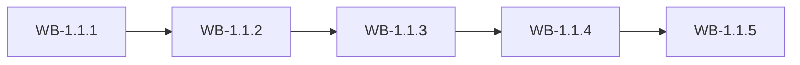

# MS-1.1: Foundation and access

**Phase:** PH-1 | **Status:** PLANNED | **Week:** 1 | **Points planned:** 29

## Goal and end-of-week demo
A running solution with the design system; Super Admin creates a company and its Company Admin; the Company Admin logs in, creates a staff role and a staff user, and the staff member sees only the permitted menu. Tenants cannot see each other's data.

## Work batches and how they connect
| Work batch | Title | Depends on | Produces for later batches |
|------------|-------|------------|----------------------------|
| WB-1.1.1 | Solution skeleton, tenancy base and design system (calibration batch) | None (first batch). | Migrations project; base entity (id, company id, created/updated by and at); `companies` table stub. |
| WB-1.1.2 | Authentication and sessions | WB-1.1.1 (solution, tenancy base, shell). | `users`, `user_sessions`, `password_reset_tokens`. |
| WB-1.1.3 | Roles, permissions, staff users and audit trail | WB-1.1.2 (users, sign-in). | `roles`, `role_permissions`, `modules`, `user_roles`, `audit_log`. |
| WB-1.1.4 | Company (tenant) management by the Super Admin | WB-1.1.3 (roles, audit log). | `companies` (complete), `company_status_history`. |
| WB-1.1.5 | Integration: foundation and access (milestone demo) | WB-1.1.1 to WB-1.1.4. | Demo script and regression results |

## Integration points
Each work batch builds on the tables, endpoints, services and screens of the batch before it (see "Depends on" and "Produces"); the last batch (WB-1.1.5) joins them into one end-to-end journey, runs the regression of earlier milestones and prepares the demo. Shared building blocks used across batches: the tenant filter and authorisation policy (MS-1.1), the audit log (WB-1.1.3), the import framework (WB-1.3.4) and the stock engine (WB-1.4.2).

## Complete requirement of the milestone
- **Solution skeleton, tenancy base and design system (calibration batch):** An empty but production-shaped solution runs locally with one command: .NET API, PostgreSQL with migrations, React admin shell with the design system, and the multi-tenant base every later table uses.
- **Authentication and sessions:** Users sign in with email or mobile and password, recover and change their password, and sessions behave as specified.
- **Roles, permissions, staff users and audit trail:** Configurable two-level RBAC works end to end, Company Admins manage staff users, and every change is recorded in an audit trail.
- **Company (tenant) management by the Super Admin:** The Super Admin creates and manages companies, each with one GSTIN, one PAN and exactly one Company Admin, and can act as a company with a full audit trail.
- **Integration: foundation and access (milestone demo):** The whole milestone works as one journey, tenant isolation is proven, and the week's demo is ready. No new features.

**Milestone acceptance:**
- Given a fresh clone, when the developer double-clicks `start.cmd`, then the API health check and the admin shell answer within 2 minutes.
- Given a user with mobile 98xxxxxxx and a password, when they sign in with the mobile number, then they reach the dashboard.
- Given a staff role with 'Products: view' only, when that staff member opens Products, then they can view but every create, edit and delete control is hidden and the API returns 403.
- Given a company with GSTIN 24AAAAA0000A1Z5, when another company is created with the same GSTIN, then it is refused.

## Specs approval
Gate G2 for this milestone: the specs of all its work batches are approved on day 1; batches then run day by day without stopping except for failures.

## Definition of done (milestone)
Every work batch DONE or carried over with the developer's OK, the integration batch passed (end-to-end journey, smoke, regression of earlier milestones), the demo accepted.
