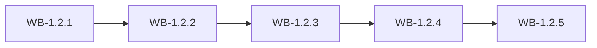

# MS-1.2: Subscriptions and platform administration

**Phase:** PH-1 | **Status:** PLANNED | **Week:** 2 | **Points planned:** 27

## Goal and end-of-week demo
Plans, subscription lifecycle, limits, subscription invoices and Razorpay payments for the platform work; the Super Admin has the platform dashboard, settings, global categories and announcements.

## Work batches and how they connect
| Work batch | Title | Depends on | Produces for later batches |
|------------|-------|------------|----------------------------|
| WB-1.2.1 | Plans and subscription lifecycle | WB-1.1.4 (companies, status). | `plans`, `plan_limits`, `subscriptions`, `subscription_events`. |
| WB-1.2.2 | Plan limits, fair-use metering and notifications foundation | WB-1.2.1 (plans and limits). | `usage_counters`, `notifications`, `notification_preferences`. |
| WB-1.2.3 | Subscription invoices and Razorpay for the platform | WB-1.2.1 (subscriptions). The platform invoice uses the platform's own GST settings; company tax setup comes in WB-1.3.3. | `subscription_invoices`, `subscription_payments`. |
| WB-1.2.4 | Platform administration | WB-1.2.3, WB-1.1.3 (audit log). | `announcements`, `global_categories`, `compliance_profiles`, `platform_settings`, `offboarding_requests`. |
| WB-1.2.5 | Integration: subscriptions and platform (milestone demo) | WB-1.2.1 to WB-1.2.4. | Demo script and regression results |

## Integration points
Each work batch builds on the tables, endpoints, services and screens of the batch before it (see "Depends on" and "Produces"); the last batch (WB-1.2.5) joins them into one end-to-end journey, runs the regression of earlier milestones and prepares the demo. Shared building blocks used across batches: the tenant filter and authorisation policy (MS-1.1), the audit log (WB-1.1.3), the import framework (WB-1.3.4) and the stock engine (WB-1.4.2).

## Complete requirement of the milestone
- **Plans and subscription lifecycle:** The Super Admin defines plans and runs each company's subscription through its whole life, with automatic expiry and suspension.
- **Plan limits, fair-use metering and notifications foundation:** Plan limits are enforced everywhere, each company's API use is metered and fairly limited, and the platform can notify users in-app and by email.
- **Subscription invoices and Razorpay for the platform:** The Super Admin bills companies with GST tax invoices and collects payment manually or online through the platform's own Razorpay.
- **Platform administration:** The Super Admin runs the platform: dashboard, announcements, global categories, platform settings, platform reports, activity log and company offboarding.
- **Integration: subscriptions and platform (milestone demo):** Trial → active → expiring → expired → suspended works with jobs, limits block correctly, payments renew subscriptions, and the demo is ready.

**Milestone acceptance:**
- Given a monthly plan ending today with 3 grace days, when the daily job runs on day 4 after the end, then the company becomes Suspended and its users cannot sign in.
- Given a plan with 5 staff, when the Company Admin creates the 6th staff user, then it is refused with the limit and an upgrade hint.
- Given a renewal, when payment succeeds in Razorpay test mode, then the webhook (with a valid signature) marks the invoice paid and extends the subscription.
- Given a maintenance notice, when any Company Admin signs in, then it is shown until dismissed.

## Specs approval
Gate G2 for this milestone: the specs of all its work batches are approved on day 1; batches then run day by day without stopping except for failures.

## Definition of done (milestone)
Every work batch DONE or carried over with the developer's OK, the integration batch passed (end-to-end journey, smoke, regression of earlier milestones), the demo accepted.
