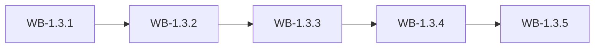

# MS-1.3: Company setup and master data

**Phase:** PH-1 | **Status:** PLANNED | **Week:** 3 | **Points planned:** 26

## Goal and end-of-week demo
A Company Admin configures the company (profile, Master Configuration with keys, tax defaults) and maintains every master, including bulk import and export.

## Work batches and how they connect
| Work batch | Title | Depends on | Produces for later batches |
|------------|-------|------------|----------------------------|
| WB-1.3.1 | Company settings and Master Configuration | WB-1.2.2 (limits, usage), WB-1.2.3 (invoices). | `company_settings`, `master_configuration`, `secret_values` (encrypted). |
| WB-1.3.2 | Catalogue masters | WB-1.2.4 (global categories), WB-1.3.1. | `categories`, `brands`, `units`, `unit_conversions`, `suppliers`. |
| WB-1.3.3 | Tax master and GST setup | WB-1.3.1. | `tax_systems`, `tax_rates`, `hsn_codes`, `company_tax_defaults`, `tax_rate_changes`. |
| WB-1.3.4 | Excel/CSV import and export framework | WB-1.3.2, WB-1.3.3. | `import_jobs`, `import_rows`. |
| WB-1.3.5 | Integration: company setup and masters (milestone demo) | WB-1.3.1 to WB-1.3.4. | Demo script and regression results |

## Integration points
Each work batch builds on the tables, endpoints, services and screens of the batch before it (see "Depends on" and "Produces"); the last batch (WB-1.3.5) joins them into one end-to-end journey, runs the regression of earlier milestones and prepares the demo. Shared building blocks used across batches: the tenant filter and authorisation policy (MS-1.1), the audit log (WB-1.1.3), the import framework (WB-1.3.4) and the stock engine (WB-1.4.2).

## Complete requirement of the milestone
- **Company settings and Master Configuration:** The Company Admin sets up the company and switches modules and channels on and off from one Master Configuration table, with keys stored safely.
- **Catalogue masters:** Categories, brands, units and suppliers are maintained per company, with global categories shared and compliance profiles applied.
- **Tax master and GST setup:** Tax rates, HSN and company defaults work as specified, and the design keeps other countries possible later.
- **Excel/CSV import and export framework:** One reusable import flow (template, upload, preview with row-level validation, fix, confirm) and export, applied to the masters so far.
- **Integration: company setup and masters (milestone demo):** A new company is fully set up from zero (settings, Master Configuration, tax, masters by import); regression and demo.

**Milestone acceptance:**
- Given WhatsApp switched on without keys, when the Admin saves, then it stays inactive and says keys are needed.
- Given a global Food category, when a company lists categories, then it sees the global ones and its own, and cannot edit the global ones.
- Given default 6% + 6% and a product overridden to 2.5% + 2.5%, when the default becomes 9% + 9%, then only products on the default change.
- Given a file with one row naming an unknown unit, when it is previewed, then that row is marked with the error and the others are valid.

## Specs approval
Gate G2 for this milestone: the specs of all its work batches are approved on day 1; batches then run day by day without stopping except for failures.

## Definition of done (milestone)
Every work batch DONE or carried over with the developer's OK, the integration batch passed (end-to-end journey, smoke, regression of earlier milestones), the demo accepted.
