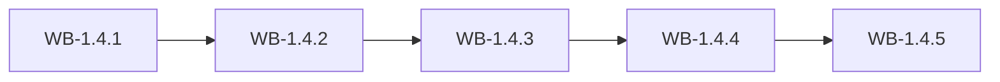

# MS-1.4: Products and the stock engine

**Phase:** PH-1 | **Status:** PLANNED | **Week:** 4 | **Points planned:** 29

## Goal and end-of-week demo
Products carry prices, tax, HSN and compliance fields; stock is held in lots and batches with FEFO, no negative stock, a movement ledger, adjustments with approval, alerts and valuation, for finished goods, raw material, packing and labels.

## Work batches and how they connect
| Work batch | Title | Depends on | Produces for later batches |
|------------|-------|------------|----------------------------|
| WB-1.4.1 | Finished goods product master | WB-1.3.2, WB-1.3.3, file storage from WB-1.2.4. | `products`, `product_images`, `product_compliance`. |
| WB-1.4.2 | Stock engine: lots, batches, ledger, FEFO and no negative stock | WB-1.4.1. | `stock_items`, `inventory_lots`, `stock_batches`, `stock_movements`, `stock_adjustments`, `approval_requests`. |
| WB-1.4.3 | Raw material, packing and label stock | WB-1.4.2. | `raw_materials`, `packing_items`, `labels`, `price_history`. |
| WB-1.4.4 | Alerts, valuation, barcodes and product import | WB-1.4.2, WB-1.4.3, WB-1.3.4. | `alert_rules`, `alerts`. |
| WB-1.4.5 | Integration: products and stock (milestone demo and phase gate) | WB-1.4.1 to WB-1.4.4. | Demo script and regression results |

## Integration points
Each work batch builds on the tables, endpoints, services and screens of the batch before it (see "Depends on" and "Produces"); the last batch (WB-1.4.5) joins them into one end-to-end journey, runs the regression of earlier milestones and prepares the demo. Shared building blocks used across batches: the tenant filter and authorisation policy (MS-1.1), the audit log (WB-1.1.3), the import framework (WB-1.3.4) and the stock engine (WB-1.4.2).

## Complete requirement of the milestone
- **Finished goods product master:** Products are complete: identity, prices, tax, HSN and the compliance fields their category requires.
- **Stock engine: lots, batches, ledger, FEFO and no negative stock:** One stock engine for every stock type: lots and batches, a movement ledger, FEFO allocation and a concurrency-safe no-negative-stock rule, with opening stock and adjustments.
- **Raw material, packing and label stock:** Raw material, packing material and labels have their masters and stock through the same engine.
- **Alerts, valuation, barcodes and product import:** Low-stock and expiry alerts, stock valuation, barcode printing and bulk product and tax import complete the stock foundation.
- **Integration: products and stock (milestone demo and phase gate):** Products and stock work as one journey; Phase 1 is demonstrated and accepted at gate G-P; Phase 2 is re-planned with the measured points per batch.

**Milestone acceptance:**
- Given a Food category product, when the form opens, then the FSSAI fields appear and are required as specified.
- Given batches expiring 10 Jan and 20 Jan, when 5 units are allocated, then the 10 Jan batch is used first.
- Given purchases at 50 and 60, when the price history is shown, then latest is 60 and average follows the quantities.
- Given a minimum of 10 and stock falling to 9, when the alert job runs, then a low-stock alert appears once.

## Specs approval
Gate G2 for this milestone: the specs of all its work batches are approved on day 1; batches then run day by day without stopping except for failures.

## Definition of done (milestone)
Every work batch DONE or carried over with the developer's OK, the integration batch passed (end-to-end journey, smoke, regression of earlier milestones), the demo accepted.
