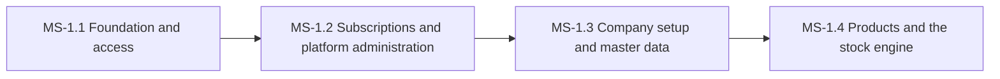

# PH-1: Platform foundation, tenancy, subscriptions and catalogue

**Status:** PLANNED | **Weeks:** 4 | **Work batches:** 20 | **Points planned:** 111

## Goal
A Super Admin can create companies and plans; a Company Admin can log in, configure the company, set up staff with permissions, maintain all master data and products, and hold correct stock (lots, batches, FEFO, no negative stock) with alerts and valuation. Everything later builds on this.

## Requirements covered
§1, §2, §3.1 to §3.3 (except Release 2 items), §4.2, §4.3, §4.4, §4.5 (stock model), §4.7, §4.8, §4.16, §4.17 (tax setup), §4.20 (approval rules), §4.21 (product compliance fields, GSTIN checks), §7 (security, audit, import/export, notifications foundation) of `FeatureListing.md` v1.4 (sections referenced as §n.n). Release 2 items are not in this plan.

## Milestones and how they connect
| Milestone | Goal | Depends on |
|-----------|------|------------|
| MS-1.1 | Foundation and access | A running solution with the design system; Super Admin creates a company and its Company Admin; the Company Admin logs in, creates a staff role and a staff user, and the staff member sees only the permitted menu. Tenants cannot see each other's data. | — |
| MS-1.2 | Subscriptions and platform administration | Plans, subscription lifecycle, limits, subscription invoices and Razorpay payments for the platform work; the Super Admin has the platform dashboard, settings, global categories and announcements. | previous milestone |
| MS-1.3 | Company setup and master data | A Company Admin configures the company (profile, Master Configuration with keys, tax defaults) and maintains every master, including bulk import and export. | previous milestone |
| MS-1.4 | Products and the stock engine | Products carry prices, tax, HSN and compliance fields; stock is held in lots and batches with FEFO, no negative stock, a movement ledger, adjustments with approval, alerts and valuation, for finished goods, raw material, packing and labels. | previous milestone |

## Cross-milestone contracts
The tenant filter and authorisation policy (MS-1.1) protect every later table and endpoint. Plans and limits (MS-1.2) gate every module. The import framework and tax services (MS-1.3) are reused by products, stock, customers and sales. The stock engine (MS-1.4) is used by purchases, sales, production, exhibitions and the store.

## Risks and decisions needed before the phase starts
- Tenant isolation must be right from WB-1.1.1: every tenant table carries the company id and a global filter; a cross-tenant test runs in every integration batch.
- The stock engine (WB-1.4.2) is the core of the product: FEFO, one lot per production batch and the no-negative-stock rule must be concurrency-safe before sales and production are built on it.
- Hosting (cloud provider) is not decided yet; it is needed only for Phase 5 (release readiness).

## Definition of done (phase)
Every milestone DONE, the phase demo accepted at gate G-P, calibration recorded, the next phase re-planned in detail with the real points per batch.
