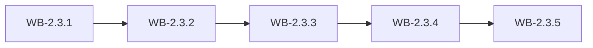

# MS-2.3: Customers, offers and messaging channels

**Phase:** PH-2 | **Status:** OUTLINE | **Week:** 7 | **Points planned:** 29

## Goal and end-of-week demo
Customer master and segments, bulk sales import, offers and coupons, and the WhatsApp/SMS/email channels.

## Work batches and how they connect
| Work batch | Title | Depends on | Requirement refs |
|------------|-------|------------|------------------|
| WB-2.3.1 | Customer management | MS-2.2 (previous milestone) | §4.11 |
| WB-2.3.2 | Bulk sales import | WB-2.3.1 | §4.10 |
| WB-2.3.3 | Offers, coupons and wholesale pricing | WB-2.3.2 | §4.13, §4.3 |
| WB-2.3.4 | Messaging channels | WB-2.3.3 | §4.13, §4.16 |
| WB-2.3.5 | Integration: customers and channels | WB-2.3.4 | MS-2.3 |

## Integration points
Each work batch builds on the tables, endpoints, services and screens of the batch before it (see "Depends on" and "Produces"); the last batch (WB-2.3.5) joins them into one end-to-end journey, runs the regression of earlier milestones and prepares the demo. Shared building blocks used across batches: the tenant filter and authorisation policy (MS-1.1), the audit log (WB-1.1.3), the import framework (WB-1.3.4) and the stock engine (WB-1.4.2).

## Complete requirement of the milestone
Written in detail when the phase becomes ACTIVE (union of the detailed work batches).

**Milestone acceptance:**
- Given the milestone demo script, when the developer follows it, then every step works without manual fixes.

## Specs approval
Gate G2 for this milestone: the specs of all its work batches are approved on day 1; batches then run day by day without stopping except for failures.

## Definition of done (milestone)
Every work batch DONE or carried over with the developer's OK, the integration batch passed (end-to-end journey, smoke, regression of earlier milestones), the demo accepted.
