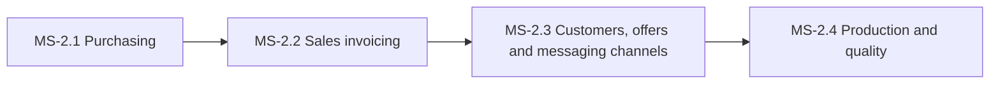

# PH-2: Buying, selling and production

**Status:** OUTLINE | **Weeks:** 4 | **Work batches:** 20 | **Points planned:** 116 (estimate)

## Goal
Purchases, sales invoicing with GST, customers, offers, messaging channels and the full production flow (BOM, RMC, batches, QA, packing, batch pricing) work, so a company can run its daily business in the panel.

## Requirements covered
§4.6, §4.9, §4.10, §4.11, §4.13 (offers, channels), §4.18, §4.20 (PO, GRN, recall), §4.21 (invoice rules, delivery challan) of `FeatureListing.md` v1.4 (sections referenced as §n.n). Release 2 items are not in this plan.

## Milestones and how they connect
| Milestone | Goal | Depends on |
|-----------|------|------------|
| MS-2.1 | Purchasing | Purchase orders, goods receipt, purchase bills with input GST, returns and supplier payments. | previous phase |
| MS-2.2 | Sales invoicing | GST tax invoices with batch-wise FEFO stock, documents, payments, returns and delivery challans. | previous milestone |
| MS-2.3 | Customers, offers and messaging channels | Customer master and segments, bulk sales import, offers and coupons, and the WhatsApp/SMS/email channels. | previous milestone |
| MS-2.4 | Production and quality | BOM and RMC, production batches from one lot, QA with rework, packing with labels, batch pricing, traceability and recall. | previous milestone |

## Cross-milestone contracts
Purchases create lots and batches (MS-2.1) that sales (MS-2.2) and production (MS-2.4) consume through the stock engine. Customers and channels (MS-2.3) serve sales, marketing and the store. Batch pricing (MS-2.4) feeds the store's batch roll-out.

## Risks and decisions needed before the phase starts
- Invoice rules (numbering, tax, B2B/B2C) are legal requirements: confirm the invoice layout with the CA before WB-2.2.2 is closed.

## Definition of done (phase)
Every milestone DONE, the phase demo accepted at gate G-P, calibration recorded, the next phase re-planned in detail with the real points per batch.
