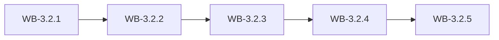

# MS-3.2: Staff and payroll

**Phase:** PH-3 | **Status:** OUTLINE | **Week:** 10 | **Points planned:** 29

## Goal and end-of-week demo
Permanent and temporary staff, attendance, statutory deductions, payroll runs, salary slips and verified bank details.

## Work batches and how they connect
| Work batch | Title | Depends on | Requirement refs |
|------------|-------|------------|------------------|
| WB-3.2.1 | Staff profiles and attendance | MS-3.1 (previous milestone) | §4.19 |
| WB-3.2.2 | Statutory master and calculation | WB-3.2.1 | §4.19 |
| WB-3.2.3 | Payroll run and salary slips | WB-3.2.2 | §4.19 |
| WB-3.2.4 | Bank details with verification | WB-3.2.3 | §4.19, §7.1 |
| WB-3.2.5 | Integration: payroll | WB-3.2.4 | MS-3.2 |

## Integration points
Each work batch builds on the tables, endpoints, services and screens of the batch before it (see "Depends on" and "Produces"); the last batch (WB-3.2.5) joins them into one end-to-end journey, runs the regression of earlier milestones and prepares the demo. Shared building blocks used across batches: the tenant filter and authorisation policy (MS-1.1), the audit log (WB-1.1.3), the import framework (WB-1.3.4) and the stock engine (WB-1.4.2).

## Complete requirement of the milestone
Written in detail when the phase becomes ACTIVE (union of the detailed work batches).

**Milestone acceptance:**
- Given the milestone demo script, when the developer follows it, then every step works without manual fixes.

## Specs approval
Gate G2 for this milestone: the specs of all its work batches are approved on day 1; batches then run day by day without stopping except for failures.

## Definition of done (milestone)
Every work batch DONE or carried over with the developer's OK, the integration batch passed (end-to-end journey, smoke, regression of earlier milestones), the demo accepted.
