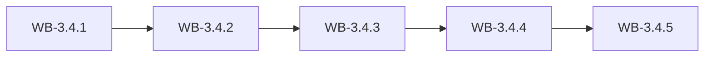

# MS-3.4: GST compliance and the CA pack

**Phase:** PH-3 | **Status:** OUTLINE | **Week:** 12 | **Points planned:** 29

## Goal and end-of-week demo
Turnover and HSN rules, the monthly GST ledger, the monthly CA review, pack and send, and the company dashboard.

## Work batches and how they connect
| Work batch | Title | Depends on | Requirement refs |
|------------|-------|------------|------------------|
| WB-3.4.1 | Turnover, HSN rules and GST ledger | MS-3.3 (previous milestone) | §4.21, §4.17, §6.2 |
| WB-3.4.2 | CA review listing | WB-3.4.1 | §4.17 |
| WB-3.4.3 | CA pack generation and sending | WB-3.4.2 | §4.17 |
| WB-3.4.4 | After-send tracking and company dashboard | WB-3.4.3 | §4.17, §4.1 |
| WB-3.4.5 | Integration: GST and CA (phase gate) | WB-3.4.4 | MS-3.4, PH-3 |

## Integration points
Each work batch builds on the tables, endpoints, services and screens of the batch before it (see "Depends on" and "Produces"); the last batch (WB-3.4.5) joins them into one end-to-end journey, runs the regression of earlier milestones and prepares the demo. Shared building blocks used across batches: the tenant filter and authorisation policy (MS-1.1), the audit log (WB-1.1.3), the import framework (WB-1.3.4) and the stock engine (WB-1.4.2).

## Complete requirement of the milestone
Written in detail when the phase becomes ACTIVE (union of the detailed work batches).

**Milestone acceptance:**
- Given the milestone demo script, when the developer follows it, then every step works without manual fixes.

## Specs approval
Gate G2 for this milestone: the specs of all its work batches are approved on day 1; batches then run day by day without stopping except for failures.

## Definition of done (milestone)
Every work batch DONE or carried over with the developer's OK, the integration batch passed (end-to-end journey, smoke, regression of earlier milestones), the demo accepted.
