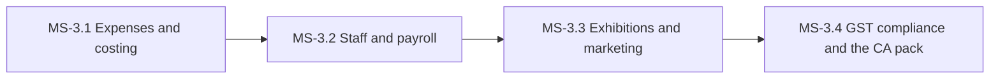

# PH-3: Costs, people, exhibitions and GST compliance

**Status:** OUTLINE | **Weeks:** 4 | **Work batches:** 20 | **Points planned:** 116 (estimate)

## Goal
Expenses and batch costing, inventory control, payroll with statutory deductions, exhibitions, marketing campaigns, the monthly GST ledger and the CA pack, and the company dashboard.

## Requirements covered
§4.1, §4.12, §4.13 (campaigns), §4.14, §4.15, §4.17 (CA pack), §4.18 (costing), §4.19, §4.20 (count, write-offs, scanning), §4.21 (turnover, HSN) of `FeatureListing.md` v1.4 (sections referenced as §n.n). Release 2 items are not in this plan.

## Milestones and how they connect
| Milestone | Goal | Depends on |
|-----------|------|------------|
| MS-3.1 | Expenses and costing | Expenses of every kind, approximate daily and final month-end batch costing, stock counts, write-offs, scanning and the day-wise sales register. | previous phase |
| MS-3.2 | Staff and payroll | Permanent and temporary staff, attendance, statutory deductions, payroll runs, salary slips and verified bank details. | previous milestone |
| MS-3.3 | Exhibitions and marketing | Exhibitions from setup to ROI, quick stall billing, and marketing campaigns. | previous milestone |
| MS-3.4 | GST compliance and the CA pack | Turnover and HSN rules, the monthly GST ledger, the monthly CA review, pack and send, and the company dashboard. | previous milestone |

## Cross-milestone contracts
Expenses and payroll (MS-3.1, MS-3.2) feed batch costing and profit. Exhibitions (MS-3.3) use the sales and delivery-challan flows. The GST ledger and CA pack (MS-3.4) read every financial record created so far.

## Risks and decisions needed before the phase starts
- Statutory rates (PF, ESI, Professional Tax, TDS) and the CA pack format must be confirmed with the CA before their batches close.

## Definition of done (phase)
Every milestone DONE, the phase demo accepted at gate G-P, calibration recorded, the next phase re-planned in detail with the real points per batch.
