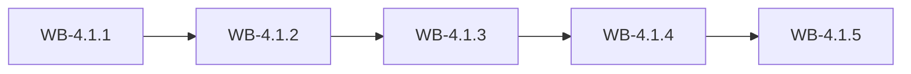

# MS-4.1: Storefront API

**Phase:** PH-4 | **Status:** OUTLINE | **Week:** 13 | **Points planned:** 29

## Goal and end-of-week demo
Company-scoped APIs for catalogue, customers, cart, orders and payments, with idempotency, reservation and webhooks.

## Work batches and how they connect
| Work batch | Title | Depends on | Requirement refs |
|------------|-------|------------|------------------|
| WB-4.1.1 | API platform and catalogue APIs | PH-3 (previous phase) | §5.8, §5.2, §4.18 |
| WB-4.1.2 | Customer identity APIs | WB-4.1.1 | §5.1, §5.6, §5.8, §5.12, §7.1 |
| WB-4.1.3 | Cart and order creation | WB-4.1.2 | §5.8, §5.11 |
| WB-4.1.4 | Payments, COD and webhooks | WB-4.1.3 | §5.4, §5.11, §5.8 |
| WB-4.1.5 | Integration: storefront API | WB-4.1.4 | MS-4.1 |

## Integration points
Each work batch builds on the tables, endpoints, services and screens of the batch before it (see "Depends on" and "Produces"); the last batch (WB-4.1.5) joins them into one end-to-end journey, runs the regression of earlier milestones and prepares the demo. Shared building blocks used across batches: the tenant filter and authorisation policy (MS-1.1), the audit log (WB-1.1.3), the import framework (WB-1.3.4) and the stock engine (WB-1.4.2).

## Complete requirement of the milestone
Written in detail when the phase becomes ACTIVE (union of the detailed work batches).

**Milestone acceptance:**
- Given the milestone demo script, when the developer follows it, then every step works without manual fixes.

## Specs approval
Gate G2 for this milestone: the specs of all its work batches are approved on day 1; batches then run day by day without stopping except for failures.

## Definition of done (milestone)
Every work batch DONE or carried over with the developer's OK, the integration batch passed (end-to-end journey, smoke, regression of earlier milestones), the demo accepted.
