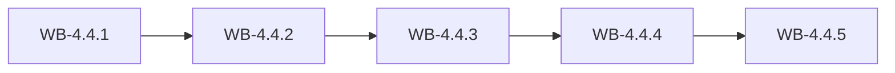

# MS-4.4: Feedback, complaints and store compliance

**Phase:** PH-4 | **Status:** OUTLINE | **Week:** 16 | **Points planned:** 29

## Goal and end-of-week demo
Reviews and feedback, complaint SLAs, storefront compliance and online store reports.

## Work batches and how they connect
| Work batch | Title | Depends on | Requirement refs |
|------------|-------|------------|------------------|
| WB-4.4.1 | Reviews and feedback | MS-4.3 (previous milestone) | §5.13 |
| WB-4.4.2 | Complaints and SLAs | WB-4.4.1 | §5.10 |
| WB-4.4.3 | Storefront compliance, security and performance | WB-4.4.2 | §5.10, §5.11 |
| WB-4.4.4 | Online store reports | WB-4.4.3 | §6.8, §5.13 |
| WB-4.4.5 | Integration: store (phase gate) | WB-4.4.4 | MS-4.4, PH-4 |

## Integration points
Each work batch builds on the tables, endpoints, services and screens of the batch before it (see "Depends on" and "Produces"); the last batch (WB-4.4.5) joins them into one end-to-end journey, runs the regression of earlier milestones and prepares the demo. Shared building blocks used across batches: the tenant filter and authorisation policy (MS-1.1), the audit log (WB-1.1.3), the import framework (WB-1.3.4) and the stock engine (WB-1.4.2).

## Complete requirement of the milestone
Written in detail when the phase becomes ACTIVE (union of the detailed work batches).

**Milestone acceptance:**
- Given the milestone demo script, when the developer follows it, then every step works without manual fixes.

## Specs approval
Gate G2 for this milestone: the specs of all its work batches are approved on day 1; batches then run day by day without stopping except for failures.

## Definition of done (milestone)
Every work batch DONE or carried over with the developer's OK, the integration batch passed (end-to-end journey, smoke, regression of earlier milestones), the demo accepted.
