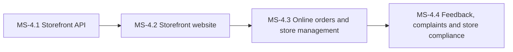

# PH-4: eCommerce store

**Status:** OUTLINE | **Weeks:** 4 | **Work batches:** 20 | **Points planned:** 116 (estimate)

## Goal
Each company on the eCommerce plan has its own store on its own domain: catalogue, checkout with Razorpay and COD, customer accounts, online order handling, returns, content, reviews and complaints, all through company-scoped APIs.

## Requirements covered
§5.1 to §5.13 (Release 1 items), §4.18 (website batch roll-out and pause), §6.8, §7.1 (consent) of `FeatureListing.md` v1.4 (sections referenced as §n.n). Release 2 items are not in this plan.

## Milestones and how they connect
| Milestone | Goal | Depends on |
|-----------|------|------------|
| MS-4.1 | Storefront API | Company-scoped APIs for catalogue, customers, cart, orders and payments, with idempotency, reservation and webhooks. | previous phase |
| MS-4.2 | Storefront website | The common store design with company branding, catalogue, checkout and the customer account. | previous milestone |
| MS-4.3 | Online orders and store management | Admin order handling, returns and refunds, store settings and domains, and website content. | previous milestone |
| MS-4.4 | Feedback, complaints and store compliance | Reviews and feedback, complaint SLAs, storefront compliance and online store reports. | previous milestone |

## Cross-milestone contracts
The storefront API (MS-4.1) is the only way the website (MS-4.2) reaches data; orders it creates are handled in the panel (MS-4.3); reviews and complaints (MS-4.4) link back to orders and batches.

## Risks and decisions needed before the phase starts
- Storefront look matters most to customers: MS-4.2 starts UI-first (prototype every store screen on mock data, freeze, then wire).
- Custom domains need TLS certificates per domain; the approach is decided in WB-4.3.3's tech spec.

## Mobile-readiness (for the ERP Mobile App, PH-6, §14.4)
- Online order handling APIs (confirm, pack, ship with courier and tracking, cancel) are usable from a phone: compact list and detail payloads and status filters (WB-4.3.1).
- New-order events create a push notification through the notification service (WB-4.3.1).
- The customer storefront APIs stay company-scoped and versioned, because the Release 2 customer app will reuse them.

## Definition of done (phase)
Every milestone DONE, the phase demo accepted at gate G-P, calibration recorded, the next phase re-planned in detail with the real points per batch.
