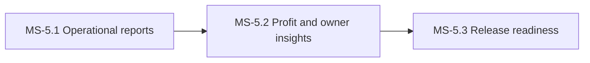

# PH-5: Reports, insights and release readiness

**Status:** OUTLINE | **Weeks:** 3 | **Work batches:** 15 | **Points planned:** 87 (estimate)

## Goal
Every report and profit analysis, owner insights, the remaining platform features, and a release that has passed security, performance and acceptance checks.

## Requirements covered
§6.1 to §6.10, §7, §7.1 (Release 1 items), release readiness of `FeatureListing.md` v1.4 (sections referenced as §n.n). Release 2 items are not in this plan.

## Milestones and how they connect
| Milestone | Goal | Depends on |
|-----------|------|------------|
| MS-5.1 | Operational reports | The report framework and the stock, sales, purchase, production, customer, marketing and exhibition reports. | previous phase |
| MS-5.2 | Profit and owner insights | Cost and profit reports, batch and period profit analytics, owner insights and the remaining platform features. | previous milestone |
| MS-5.3 | Release readiness | Security, performance, onboarding of the first companies and the go-live checklist. | previous milestone |

## Cross-milestone contracts
Reports (MS-5.1, MS-5.2) read every module; release readiness (MS-5.3) checks the whole system.

## Risks and decisions needed before the phase starts
- Hosting and the cloud provider must be decided before MS-5.3 (gate G3: the developer applies the infrastructure).

## Definition of done (phase)
Every milestone DONE, the phase demo accepted at gate G-P, calibration recorded, the next phase re-planned in detail with the real points per batch.
