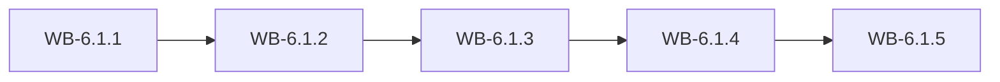

# MS-6.1: Foundation, access and stock lookup

**Phase:** PH-6 | **Status:** OUTLINE | **Week:** 20 | **Points planned:** 29

## Goal and end-of-week demo
A running Flutter app on the boilerplate and the generated API client; a Company Admin or Staff member signs in, sees only the permitted menu and the dashboard, looks up stock and scans a barcode, and receives a notification.

## Work batches and how they connect
| Work batch | Title | Depends on | Requirement refs |
|------------|-------|------------|------------------|
| WB-6.1.1 | Flutter app skeleton on the boilerplate (calibration batch) | PH-5 (previous phase) | §14.1, §14.7 |
| WB-6.1.2 | Sign-in, sessions and role-based menu | WB-6.1.1 | §2, §14.2 |
| WB-6.1.3 | Dashboard and notifications | WB-6.1.2 | §4.1, §7, §14.2 |
| WB-6.1.4 | Stock lookup and camera barcode scan | WB-6.1.3 | §4.3 to §4.8, §14.2 |
| WB-6.1.5 | Integration: foundation and access (milestone demo) | WB-6.1.1 to WB-6.1.4 | MS-6.1 |

## Integration points
Each work batch builds on the screens, API calls and local storage of the batch before it; the last batch joins them into one end-to-end journey on an Android emulator, runs the regression of earlier milestones and prepares the demo. Shared building blocks: the generated API client, the auth and session layer (WB-6.1.2), the barcode scanner (WB-6.1.4) and the offline queue (WB-6.2.3).

## Complete requirement of the milestone
Written in detail when the phase becomes ACTIVE (union of the detailed work batches).

**Milestone acceptance:**
- Given the milestone demo script, when the developer follows it on an Android emulator (and on a device where marked), then every step works without manual fixes.

## Specs approval
Gate G2 for this milestone: the specs of all its work batches are approved on day 1; batches then run day by day without stopping except for failures.

## Definition of done (milestone)
Every work batch DONE or carried over with the developer's OK, the integration batch passed (end-to-end journey, smoke, regression of earlier milestones), the demo accepted.
