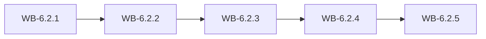

# MS-6.2: Selling, offline billing and orders

**Phase:** PH-6 | **Status:** OUTLINE | **Week:** 21 | **Points planned:** 29

## Goal and end-of-week demo
A user creates a sales invoice and a stall bill with barcode scanning, works offline and syncs later without duplicates, shares the PDF, and handles online orders and customer lookup.

## Work batches and how they connect
| Work batch | Title | Depends on | Requirement refs |
|------------|-------|------------|------------------|
| WB-6.2.1 | Quick sales invoice | MS-6.1 (previous milestone) | §4.10, §4.21, §14.2 |
| WB-6.2.2 | Stall and exhibition billing | WB-6.2.1 | §4.14, §14.2 |
| WB-6.2.3 | Offline queue and sync (billing and scans only) | WB-6.2.2 | §14.4, §14.5 |
| WB-6.2.4 | Online orders and customer lookup | WB-6.2.3 | §5.9, §4.11, §14.2, §14.3 |
| WB-6.2.5 | Integration: selling and offline (milestone demo) | WB-6.2.1 to WB-6.2.4 | MS-6.2 |

## Integration points
Each work batch builds on the screens, API calls and local storage of the batch before it; the last batch joins them into one end-to-end journey on an Android emulator, runs the regression of earlier milestones and prepares the demo. Shared building blocks: the generated API client, the auth and session layer (WB-6.1.2), the barcode scanner (WB-6.1.4) and the offline queue (WB-6.2.3).

## Complete requirement of the milestone
Written in detail when the phase becomes ACTIVE (union of the detailed work batches).

**Milestone acceptance:**
- Given the milestone demo script, when the developer follows it on an Android emulator (and on a device where marked), then every step works without manual fixes.

## Specs approval
Gate G2 for this milestone: the specs of all its work batches are approved on day 1; batches then run day by day without stopping except for failures.

## Definition of done (milestone)
Every work batch DONE or carried over with the developer's OK, the integration batch passed (end-to-end journey, smoke, regression of earlier milestones), the demo accepted.
