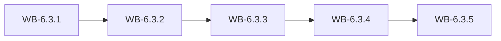

# MS-6.3: Field work, approvals and release

**Phase:** PH-6 | **Status:** OUTLINE | **Week:** 22 | **Points planned:** 29

## Goal and end-of-week demo
A user receives goods, records production and quality, raises and approves adjustments, adds expenses with receipt photos, sees salary slips and owner insights; the app passes device testing and is ready for store publishing by the developer.

## Work batches and how they connect
| Work batch | Title | Depends on | Requirement refs |
|------------|-------|------------|------------------|
| WB-6.3.1 | Goods receipt (GRN) | MS-6.2 (previous milestone) | §4.9, §4.20, §14.3 |
| WB-6.3.2 | Production, quality check and packing | WB-6.3.1 | §4.6, §4.18, §14.3 |
| WB-6.3.3 | Adjustments, approvals, expenses and staff self-service | WB-6.3.2 | §4.20, §4.12, §4.19, §2, §14.3 |
| WB-6.3.4 | Owner insights and polish | WB-6.3.3 | §4.15, §6.9, §14.3, §14.7 |
| WB-6.3.5 | Integration and release readiness (phase gate) | WB-6.3.1 to WB-6.3.4 | MS-6.3, PH-6 |

## Integration points
Each work batch builds on the screens, API calls and local storage of the batch before it; the last batch joins them into one end-to-end journey on an Android emulator, runs the regression of earlier milestones and prepares the demo. Shared building blocks: the generated API client, the auth and session layer (WB-6.1.2), the barcode scanner (WB-6.1.4) and the offline queue (WB-6.2.3).

## Complete requirement of the milestone
Written in detail when the phase becomes ACTIVE (union of the detailed work batches).

**Milestone acceptance:**
- Given the milestone demo script, when the developer follows it on an Android emulator (and on a device where marked), then every step works without manual fixes.

## Specs approval
Gate G2 for this milestone: the specs of all its work batches are approved on day 1; batches then run day by day without stopping except for failures.

## Definition of done (milestone)
Every work batch DONE or carried over with the developer's OK, the integration batch passed (end-to-end journey, smoke, regression of earlier milestones), the demo accepted.
