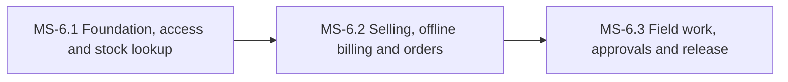

# PH-6: ERP Mobile App (Flutter)

**Status:** OUTLINE | **Weeks:** 3 | **Work batches:** 15 | **Points planned:** 87 (estimate)

## Goal
Company Admins and Company Staff run their daily work from a Flutter phone app (Android first, then iOS): sell and bill (including offline at a stall), look up and scan stock, handle online orders, receive goods, record production and quality, approve adjustments, add expenses, and see owner insights. It reuses the web APIs, rules and permissions; it is not a copy of the whole web panel.

## Requirements covered
§14 (14.1 to 14.7) of `FeatureListing.md` v1.5, which draws on §2, §4.1, §4.3 to §4.12, §4.14, §4.15, §4.18 to §4.21, §5.9, §6.9 and §7 (sections referenced as §n.n). The customer storefront app (§5.14) is a separate app in Release 2 and is not in this phase.

## Scope decisions (FeatureListing §9, rows 42 to 46)
- Users: Company Admin and Company Staff only. Not Super Admin, not CA.
- Scope: the Must and Should groups of §14.2 and §14.3.
- Offline: sales billing, stall billing and stock scans only.
- Camera barcode scanning only; no Bluetooth printers.
- Android first, then iOS (an Apple developer account and a Mac are needed for the iOS build).
- Built on the developer's Flutter boilerplate (Clean Pattern Boilerplate).

## Milestones and how they connect
| Milestone | Goal | Depends on |
|-----------|------|------------|
| MS-6.1 | Foundation, access and stock lookup: a running Flutter app on the generated API client; sign-in, role-based menu, dashboard, stock lookup with barcode scan, notifications. | PH-5 (web system complete) |
| MS-6.2 | Selling, offline billing and orders: quick sales invoice, stall billing with offline queue and sync, online order handling, customer lookup. | previous milestone |
| MS-6.3 | Field work, approvals and release: goods receipt, production and QA, adjustments and approvals, expenses, staff self-service, owner insights, device testing and store release readiness. | previous milestone |

## Cross-milestone contracts
The mobile-ready API conventions (§14.4, set up in PH-1 and extended in PH-2 to PH-5) are the contract: versioned routes, paginated lists, idempotent creates, device sessions, push tokens and the offline sync endpoint. The Flutter client is generated from the OpenAPI document. The menu is built from the same role and permission API as the web.

## Risks and decisions needed before the phase starts
- Offline invoice numbering must satisfy the GST numbering rules (§4.21); the approach is agreed with the CA in WB-2.2.2 and re-confirmed in WB-6.2.3.
- iOS needs an Apple developer account and a Mac; confirm before MS-6.3. Without them only the Android app is delivered.
- Store publishing (Play Store and App Store) is done by the developer (gate G4); the toolkit builds and tests but never publishes.
- Push notifications need a Firebase (FCM and APNs) project for each environment.
- The toolkit cannot test on real devices: a manual device checklist is part of WB-6.3.5.

## Definition of done (phase)
Every milestone DONE, the phase demo accepted at gate G-P, the manual device checklist passed by the developer (G4), calibration recorded.
